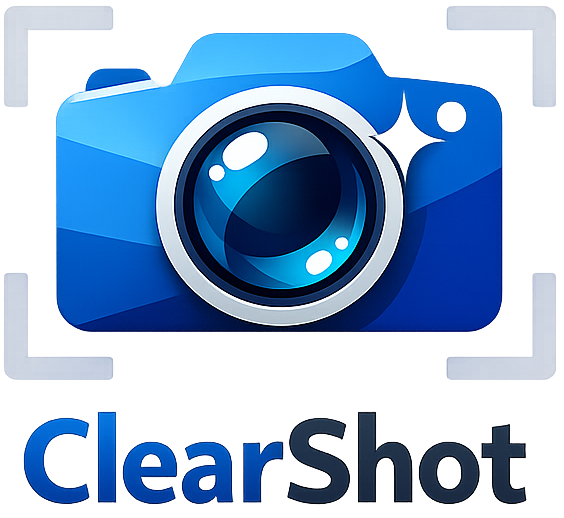
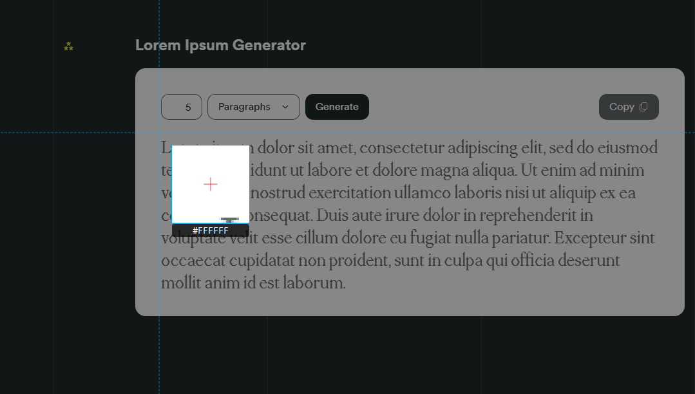
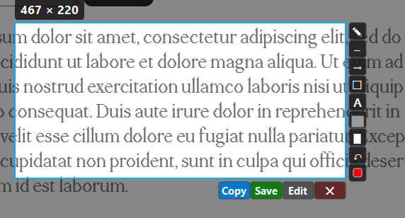
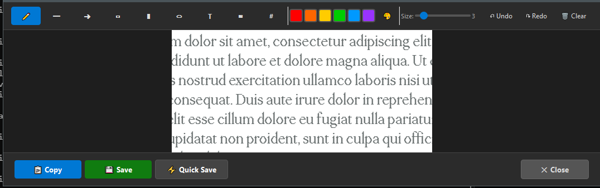
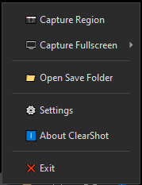
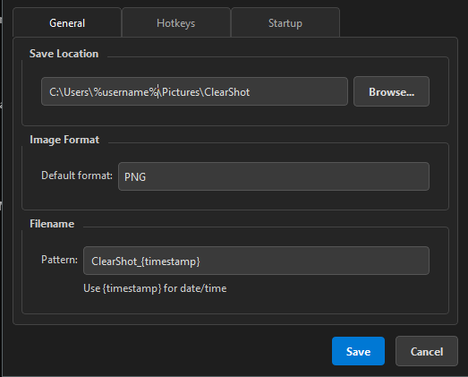
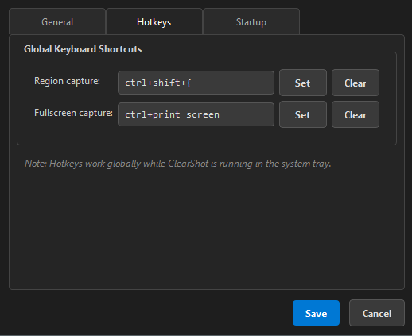
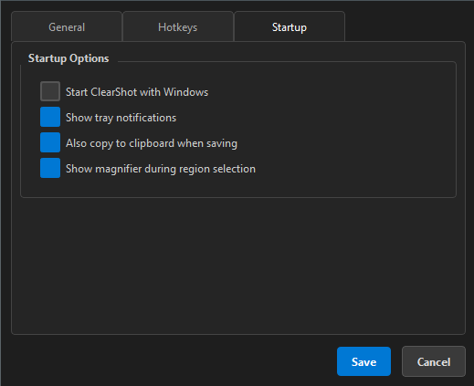

<p align="center">
  
</p>

<h1 align="center">ClearShot</h1>

<p align="center">
  <b>Screenshot capture, annotation, and screen recording for Windows</b><br>
  Capture regions or fullscreen • Annotate with built-in tools • Copy or save instantly
</p>

<p align="center">
  <a href="https://github.com/GoblinRules/ClearShot/releases"></a>
  <a href="LICENSE"></a>
  
</p>

---

## Documentation

- [Download the latest release](https://github.com/GoblinRules/ClearShot/releases/latest)
- [Step-by-step how-to guide](docs/HOW_TO.md)
- [Troubleshooting and recording recovery](docs/TROUBLESHOOTING.md)
- [Development and contributing](CONTRIBUTING.md)
- [Release notes](RELEASE_NOTES.md)

ClearShot runs in the Windows system tray. After launching, look beside the clock or inside the hidden-icons menu. Packaged releases support Windows 10/11 and include their runtime dependencies; Python is only needed for source runs.

## ✨ Features

- **Region Capture** — Select any area of your screen with a crosshair overlay
- **Fullscreen Capture** — Grab your entire screen (or pick a specific monitor)
- **Built-in Annotation Editor** — Draw, highlight, blur, and add text before saving
- **Screen Recording** — Record a region, monitor, or all screens with capture-excluded floating controls, live annotations, and audio modes
- **Quick Actions** — Copy to clipboard, save to file, or quick-save with one click
- **System Tray** — Lives quietly in your tray, always ready
- **Customizable Hotkeys** — Set your own screenshot and recording keybindings
- **Auto-Start** — Optionally launch on Windows startup
- **Dark UI** — Clean, modern dark theme

---

## 📸 Screenshots

### Region Selection
> Click and drag to select any region. A crosshair cursor with dimension display helps you capture exactly what you need.



### Selection Options
> After selecting a region, choose to copy, save, or open the annotation editor.



### Built-in Annotation Editor
> Full annotation toolbar with pen, line, arrow, rectangle, ellipse, text, blur, and numbered markers. Adjust colors and sizes, undo/redo, then copy or save.



### System Tray Menu
> Right-click the tray icon to access all features — capture, open save folder, settings, and more.



### Settings
> Configure save location, image format, filename pattern, hotkeys, and startup behavior.

| General | Hotkeys | Startup |
|---------|---------|---------|
|  |  |  |

---

## 🚀 Getting Started

### Option 1: Download a Release

1. Go to the [Releases](https://github.com/GoblinRules/ClearShot/releases) page
2. Download `ClearShot_Setup_<version>.exe` for the recommended full installer, or `ClearShot_Portable_<version>.zip` for a portable folder
3. Exit any older ClearShot instance from its tray menu, then install or extract the complete portable folder and run `ClearShot.exe`

The installer and portable ZIP run from their own folders and do not extract runtime files into Windows Temp. Keep the portable folder's `_internal` directory alongside the EXE. A standalone `ClearShot.exe` is also available; it extracts a smaller runtime into Temp and normally has two processes (launcher and application).

### Option 2: Run from Source

**Requirements:** Python 3.10+

```bash
# Clone the repository
git clone https://github.com/GoblinRules/ClearShot.git
cd ClearShot

# Install dependencies
pip install -r requirements.txt

# Run
python main.py
```

---

## 🎯 How to Use

### Taking a Screenshot

| Action | Default Hotkey |
|--------|---------------|
| **Region Capture** | `Print Screen` |
| **Fullscreen Capture** | `Ctrl + Print Screen` |

You can also right-click the **system tray icon** to access capture options.

### Screen Recording

Right-click the tray icon and open **Screen Record**:

- **Record Region** - Drag to select an area, then recording starts
- **Record All Monitors** - Record the full virtual desktop
- **Record Monitor** - Pick a specific display
- **Floating Recording Controls** - The REC timer and annotation toolbar appear automatically, stay out of the saved video, and become more prominent on hover
- **Show / Hide Annotation Tools** - Hold the configured annotation input key to draw pen strokes, arrows, shapes, text, and numbered markers into the live recording
- **Pause Recording / Resume Recording** - Temporarily pause and continue the active recording from the tray, hotkey, or floating toolbar
- **Stop Recording** - Finish and save the recording to your configured recording folder

Default recording hotkeys:

| Action | Default Hotkey |
|--------|---------------|
| **Pause/Resume Recording** | `Ctrl + Alt + Shift + P` |
| **Stop Recording** | `Ctrl + Alt + Shift + X` |

Recording settings include a dedicated save folder, MP4/MKV export format, frame rate, visible recording border, hold-to-draw annotation input, microphone input, and system audio from a selected output device.

Choose **No audio** (the default), **Microphone input**, or **System audio**. Microphone and system audio are separate modes; simultaneous mixing is not offered. Available frame rates are 10, 15, 20, and 30 FPS; the default is 15 FPS. Hold `Ctrl + Alt` by default to draw live annotations.

Microphone choices come from Windows audio endpoints. The refresh icon updates microphone and system-output lists after reconnecting devices. Missing selections are marked unavailable; ClearShot does not silently switch microphones. Previously saved microphone names are recognized when they match an available device.

Pause excludes both audio and video and freezes the REC timer. Under capture load, repeated frames preserve elapsed time instead of speeding up playback. Stop shows finalizing/exporting status; the app checks encoder results before reporting that a file was saved.

### Region Capture

1. Press `Print Screen` (or your custom hotkey)
2. Your screen dims — click and drag to select the area
3. Release to see the selection toolbar:
   - **📋 Copy** — Copy to clipboard
   - **💾 Save** — Save to file (opens file dialog)
   - **⚡ Quick Save** — Save instantly to your configured folder
   - **✏️ Edit** — Open the annotation editor
   - **✕ Cancel** — Discard the capture

### Annotation Editor

After opening the editor, you have access to a full toolbar:

| Tool | Description |
|------|-------------|
| ✏️ **Pen** | Freehand drawing |
| ─ **Line** | Straight lines |
| → **Arrow** | Arrows with heads |
| □ **Rectangle** | Outlined rectangles |
| ■ **Filled Rectangle** | Solid rectangles |
| ○ **Ellipse** | Circles and ovals |
| **T** **Text** | Click to type text |
| ▪ **Blur** | Blur sensitive content |
| **#** **Counter** | Numbered markers (1, 2, 3...) |

- Pick colors from the palette
- Adjust brush/line size with the slider
- **Undo / Redo** your edits
- **Clear** to start over

### Settings

Right-click the tray icon → **Settings**. The settings window offers four tabs:

- **General** — Screenshot save location, image format, filename pattern, recording folder, recording format, audio, and border options
- **Hotkeys** — Customize screenshot and screen recording shortcuts
- **Startup** — Enable/disable launching ClearShot on Windows startup
- **About** — Application information

Default screenshots go to `%USERPROFILE%\Pictures\ClearShot`; recordings go to its `Recordings` subfolder. Settings are stored separately at `%APPDATA%\ClearShot\settings.json`, including for portable builds. Finish recording and exit from the tray before upgrading; extract a new portable ZIP into a fresh folder and keep its `_internal` directory alongside the EXE.

---

## 🔨 Building the Executable

```bash
# Install PyInstaller
pip install pyinstaller

# Build the standalone EXE and the runtime folder used by the installer/ZIP
python -m PyInstaller build.spec --clean -y
```

Outputs are `dist/ClearShot.exe` and `dist/ClearShot/`. Compile `installer.iss` with Inno Setup 6 to build the full installer. ZIP the complete `dist/ClearShot/` folder for the portable ZIP.

Run regression checks with `python -m unittest discover -s tests -v`. On Windows, `python tests/smoke_app.py` also verifies real screen capture, pause/resume, consecutive sessions, and quitting during a recording using temporary test videos.

For an opt-in hardware audio check, run `python tests/smoke_recording_audio.py --hardware`. This briefly records each connected microphone and default system audio, tests pause/resume and export, then removes all test media locally.

### Troubleshooting

Application logs are kept locally in `%LOCALAPPDATA%\ClearShot\logs`. The main log rotates at 1 MB with three backups; native crash reports retain the current and previous run. These files are never uploaded automatically.

If the app is exiting or stopping a recording, let it finish saving. The installer asks a running app to exit cleanly; older versions need to be closed from the tray first.

Recordings use a `ClearShot_recovery_*` working folder inside the selected recording save directory, not Windows Temp. Successful exports remove it. If capture, audio, or export fails, the error reports its location and retains the intermediate `video.mkv` and `audio.wav` when available. Try opening `video.mkv` to recover the silent video. A failed or interrupted recording may be incomplete; these files are not a guarantee of full recovery. After recovering anything needed, you can delete that recording's recovery folder while ClearShot is closed.

Leave enough space on the recording drive for video, uncompressed temporary audio (about 660 MiB per hour), and the final export. ClearShot stops with an error if free space drops below 256 MB. Unavailable save drives no longer prevent startup, but must be reconnected or changed in Settings before saving there.

Do not delete `_MEI` folders used by running applications. These folders are shared naming conventions for PyInstaller programs, not ClearShot-specific files. Use the installer or portable ZIP to avoid depending on Temp for ClearShot's runtime.

---

## 📁 Project Structure

```
ClearShot/
├── main.py              # Entry point with single-instance lock
├── app.py               # System tray app & core orchestration
├── overlay.py           # Screen overlay for region selection
├── recording.py         # Screen recording worker and recording overlays
├── annotator.py         # Built-in annotation editor
├── capture.py           # Screen capture via mss
├── clipboard_utils.py   # Clipboard operations (Win32)
├── config.py            # Settings persistence
├── constants.py         # App constants & defaults
├── settings_window.py   # Settings dialog (PyQt6)
├── tools.py             # Annotation tool implementations
├── requirements.txt     # Python dependencies
├── build.spec           # PyInstaller build configuration
├── installer.iss        # Inno Setup installer script
└── assets/
    ├── icon.ico         # Application icon
    ├── icon.png         # Application icon (PNG)
    └── screenshots/     # README screenshots
```

---

## ⚠️ Disclaimer

This software is provided "as is", without warranty of any kind. Use it at your own risk. The authors are not liable for any damages or data loss resulting from its use.

**Privacy & Security:** ClearShot captures screen content and stores images/videos locally on your machine. It does **not** transmit any data externally. However, screenshots and recordings may contain sensitive information — be mindful of what you capture, where you save it, and with whom you share it. You are solely responsible for the content you capture and distribute.

---

## 📄 License

This project is licensed under the [MIT License](LICENSE).

Selected in-app interface icons are from Pictogrammers Material Design Icons,
licensed under Apache-2.0. See [THIRD_PARTY_NOTICES.md](THIRD_PARTY_NOTICES.md).
